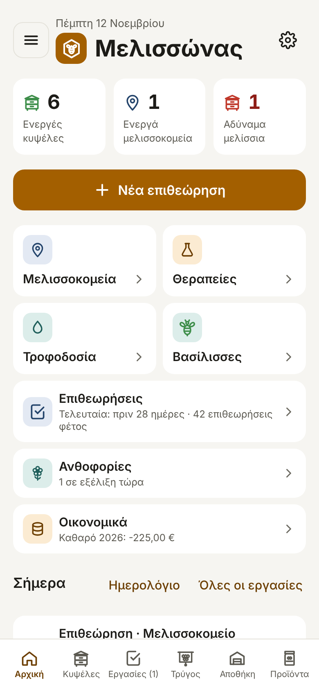

# 🐝 Μελισσώνας

Εφαρμογή διαχείρισης μελισσοκομείου στα ελληνικά. Ένα αρχείο HTML, χωρίς εξαρτήσεις, χωρίς βήμα μεταγλώττισης, σχεδιασμένη για χρήση στο κινητό δίπλα στις κυψέλες.

**[▶ Δοκίμασε το demo](https://nfgeorgitsopoulos.github.io/melissonas/)** — με δοκιμαστικά δεδομένα, αποθηκεύονται τοπικά στον φυλλομετρητή σου.

| | | |
|---|---|---|
|  |  |  |
|  |  |  |

## Τι κάνει

**Μελίσσια.** Μελισσοκομεία και κυψέλες με πλαίσια, ορόφους, υλικό και χρώμα. Επιθεωρήσεις μεμονωμένα ή μαζικά, με δύναμη μελισσιού, γόνο, αποθέματα μελιού, συμπεριφορά, υγεία και μετρήσεις βαρρόα. Ιστορικό και γραφήματα εξέλιξης ανά κυψέλη.

**Βασίλισσες.** Ηλικία, προέλευση, σήμανση, βασιλοτροφία ανά παρτίδα.

**Θεραπείες.** Σκεύασμα, δραστική ουσία, δόσεις με μεσοδιαστήματα, υπενθυμίσεις επόμενης δόσης, ρυθμιζόμενα όρια βαρρόα για ζάχαρη και για συρτάρι.

**Τροφοδοσία.** Σιρόπι, ζυμάρι και συμπληρώματα, με υπολογιστή σιροπιού και αυτόματη αφαίρεση από την αποθήκη.

**Παραγωγή.** Τρύγος ανά προϊόν με παρτίδες, προϊόντα, αποθήκη εξοπλισμού σε δεκατρείς κατηγορίες, οικονομικά με έξοδα, πωλήσεις και κόστος ανά κιλό.

**Ανάλυση.** Κατάταξη κυψελών με βαθμό 0–100 από τρύγο, δύναμη, βαρρόα και γόνο. Σύγκριση κυψελών σε πίνακα. Ανθοφορικό ημερολόγιο της περιοχής ανά δεκαήμερο. Ετήσια αναφορά.

**Πρακτικά.** Εργασίες με προτεραιότητες και καταστήματα, υπενθυμίσεις επιθεώρησης, σκούρο θέμα, εξαγωγή σε JSON και CSV, επαναφορά από αντίγραφο.

**Ημερολόγιο.** Όλα τα γεγονότα του μήνα σε ένα πλέγμα, με φίλτρα ανά είδος: εργασίες, θεραπείες, βασιλοτροφία, επιθεωρήσεις, ταΐσματα, τρύγος, οικονομικά. Εμφανίζει επίσης τις ανθοφορίες σε εξέλιξη και την ελληνική αντιπυρική περίοδο, από 1 Μαΐου έως 31 Οκτωβρίου κάθε έτους, που υπολογίζεται από την ημερομηνία και δεν χρειάζεται καταχώριση.

## Ο ρόλος μου σε αυτό το έργο

Είμαι μελισσοκόμος, όχι προγραμματιστής, και το λέω ανοιχτά γιατί είναι μέρος του τι δείχνει αυτό το έργο.

Δικά μου είναι ο σχεδιασμός του προϊόντος, το μοντέλο δεδομένων, οι μελισσοκομικές προδιαγραφές και κάθε απόφαση λειτουργίας: τι καταγράφεται σε μια επιθεώρηση, πώς υπολογίζεται η δύναμη ενός μελισσιού, πότε μια θεραπεία θεωρείται ολοκληρωμένη, πώς μοιράζεται ο τρύγος σε κυψέλες. Κάθε έκδοση δοκιμάστηκε και εγκρίθηκε από εμένα πριν δημοσιευτεί.

Ο κώδικας γράφτηκε σε συνεργασία με το Claude της Anthropic.

Στο έργο περιλαμβάνεται επίσης μετανάστευση περίπου 300 ιστορικών εγγραφών από προηγούμενη εφαρμογή, με αντιστοίχιση πεδίων και επίλυση ασυμβατοτήτων στις μονάδες, καθώς και ανάλυση των δεδομένων δύο ετών, από την οποία προέκυψαν συμπεράσματα για τον συγχρονισμό της τροφοδοσίας με τις τοπικές ανθοφορίες και για το πραγματικό κόστος λειτουργίας.

## Τεχνικά

- Ένα αρχείο `index.html`, περίπου 3.300 γραμμές, καθαρή JavaScript χωρίς βιβλιοθήκες και χωρίς βήμα μεταγλώττισης.
- Απόδοση με επαναδημιουργία του DOM και διαχείριση συμβάντων μέσω `data-` χαρακτηριστικών, με ένα αντικείμενο κατάστασης.
- Μορφοποίηση με CSS μεταβλητές, αυτόματο σκούρο θέμα, σχεδίαση για οθόνη κινητού.
- Γραφήματα σε SVG φτιαγμένα στο χέρι, χωρίς βιβλιοθήκη.
- Προσβασιμότητα: `aria` χαρακτηριστικά στα διαδραστικά στοιχεία, στόχοι αφής τουλάχιστον 40 εικονοστοιχείων.

## Αποθήκευση δεδομένων

Η εφαρμογή γράφτηκε για να τρέχει ως artifact στο claude.ai, όπου χρησιμοποιεί τη βάση δεδομένων του λογαριασμού μέσω του `window.claude.use('db')`, με συγχρονισμό σε πραγματικό χρόνο και ίδια δεδομένα σε κάθε συσκευή.

Για το δημόσιο demo προστέθηκε το [`shim.js`](shim.js): υλοποιεί το ίδιο API πάνω στο `localStorage` του φυλλομετρητή και ενεργοποιείται μόνο όταν λείπει το `window.claude`. Έτσι το ίδιο αρχείο τρέχει και στις δύο περιπτώσεις, χωρίς καμία αλλαγή στον κώδικα της εφαρμογής.

Τα δοκιμαστικά δεδομένα βρίσκονται στο [`demo-data.json`](demo-data.json) και είναι εξ ολοκλήρου φανταστικά. Για επαναφορά τους, στην κονσόλα του φυλλομετρητή: `melissonasResetDemo()`.

## Τοπική εκτέλεση

```
git clone https://github.com/nfgeorgitsopoulos/melissonas.git
cd melissonas
python3 -m http.server 8000
```

Άνοιξε το `http://localhost:8000` σε φυλλομετρητή. Δεν χρειάζεται τίποτα άλλο.

## Άδεια

[MIT](LICENSE)
